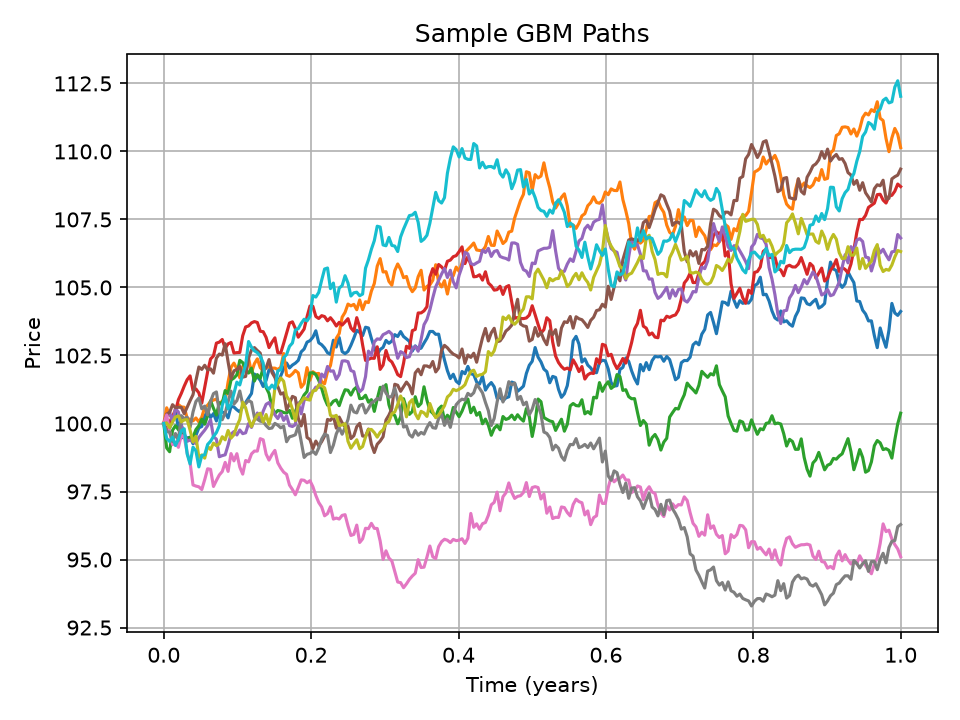
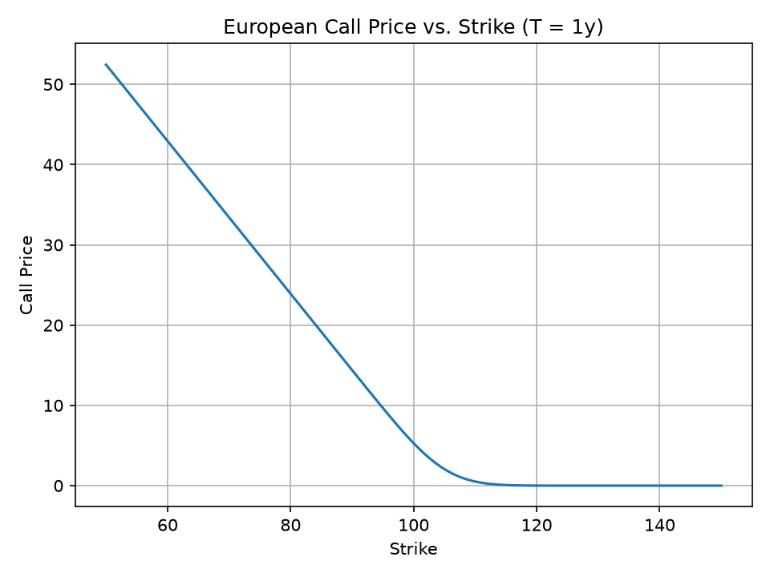

# Black-Scholes Model


Small Python demo of European option pricing with the Black-Scholes closed-form formula plus a geometric Brownian motion (GBM) path simulator for simple visualization.

## What this project does

- Prices European call and put options with the Black-Scholes model.
- Simulates sample stock-price paths under GBM.
- Generates demo artifacts under `outputs/` so readers have something concrete to inspect.

## Model inputs

- `S0`: current spot price
- `K`: strike price
- `T`: time to maturity in years
- `r`: risk-free interest rate
- `sigma`: annualized volatility

## Quick start

```bash
python3 -m venv .venv
source .venv/bin/activate
pip install -r requirements.txt
python3 model.py
```

Running the script prints a reference call price and writes these files:

- `outputs/example_output.txt`
- `outputs/sample_call_prices.csv`
- `outputs/gbm_sample_paths.png`
- `outputs/call_price_vs_strike.png`

## Reference output

The current demo run uses:

- `S0 = 100`
- `K = 105`
- `T = 1.0`
- `r = 0.05`
- `sigma = 0.05`

Console output:

```text
Black-Scholes call: 2.054336
Saved demo outputs to: outputs
```

Sample pricing table:

```csv
strike,call_price
90,14.390556
100,5.283269
105,2.054336
110,0.507751
120,0.006737
```

## Generated charts

### GBM sample paths



### Call price vs strike



## Project layout

- `model.py`: pricing function, GBM simulator, and demo-output generator
- `requirements.txt`: Python dependencies
- `outputs/`: generated charts and sample result files

## Notes

- The pricing formula here is for European options only.
- The GBM simulator is included for intuition and visualization; it is separate from the closed-form pricing function.
